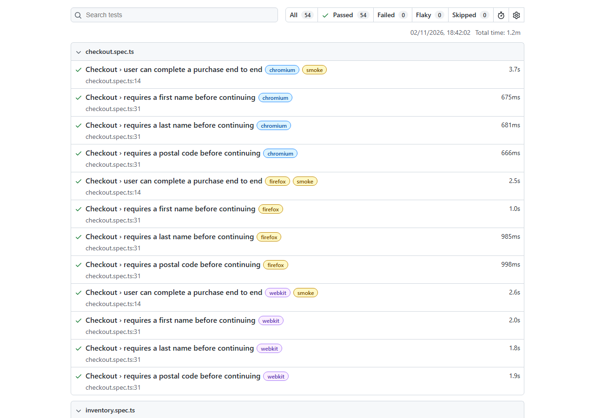

# Sauce Demo E2E Test Suite

[](https://github.com/ola20sarumi/saucedemo-playwright-e2e/actions/workflows/playwright.yml)
[](https://ola20sarumi.github.io/saucedemo-playwright-e2e/)

End-to-end and accessibility tests for the full [Sauce Demo](https://www.saucedemo.com) shop flow (login, product sorting, cart and checkout) across Chromium, Firefox and WebKit, plus API tests against a public practice API, written in Playwright and TypeScript with the Page Object Model and run in GitHub Actions on every push, every pull request and nightly.

**[View the latest test report →](https://ola20sarumi.github.io/saucedemo-playwright-e2e/)** · **[Read the test plan →](docs/TEST_PLAN.md)**



## What's covered

25 UI and accessibility test cases, each run in 3 browsers, plus 11 API tests (86 runs in total).

| Area              | Scenarios                                                                                                                                                                                                 |
| ----------------- | --------------------------------------------------------------------------------------------------------------------------------------------------------------------------------------------------------- |
| **Login**         | Successful login · wrong password · unknown user · locked-out user · empty username · empty password                                                                                                      |
| **Session**       | Logout · protected page blocks users who are not logged in                                                                                                                                                |
| **Sorting**       | Name A→Z · name Z→A · price low→high · price high→low                                                                                                                                                     |
| **Cart**          | Badge count updates on add/remove · added items appear in the cart                                                                                                                                        |
| **Checkout**      | Full purchase with order total check · first name, last name and postal code each required                                                                                                                |
| **Accessibility** | axe scan of all 7 screens (login, inventory, product details, cart and the 3 checkout steps) against WCAG 2.1 A/AA and axe best practices                                                                 |
| **API**           | Create, read, search, replace (PUT), partial update (PATCH) and delete a booking · 404 for a missing booking · invalid booking rejected · writes refused without a token · no token for wrong credentials |

The critical-path tests (login, logout, full purchase, plus the API health check and create-and-read) are tagged `@smoke` so they can run on their own as a fast check.

**About the API tests.** Sauce Demo has no backend API: login, cart and checkout all run in the browser. The API tests therefore target [Restful-booker](https://restful-booker.herokuapp.com), a public API built for practising API testing, and run as their own Playwright project (`api`) that launches no browser. They show the API-testing approach; they don't test the shop.

## Tech stack

- [Playwright Test](https://playwright.dev) 1.64 with TypeScript 6 (strict mode)
- ESLint 10 (`typescript-eslint`, `eslint-plugin-playwright`) and Prettier
- GitHub Actions on Ubuntu 24.04 / Node 22, with the HTML report published to GitHub Pages

## Project structure

```
├── pages/          Page objects: one class per screen, holding its locators and actions
├── fixtures/       Extends Playwright's `test`: page objects and an axe scanner for UI tests,
│                   an auth token and a per-test booking for API tests
├── test-data/      Users, checkout data, booking data and the accessibility baseline
├── tests/          UI specs: login, inventory (sorting and cart), checkout, accessibility
│   └── api/        API specs (Restful-booker)
├── docs/           Test plan and the report screenshot
├── .github/        CI workflow
└── playwright.config.ts
```

## Getting started

Requires Node.js 20.19+ or 22.13+.

```bash
npm install
npx playwright install
npm test
```

No configuration is needed: the suite defaults to Sauce Demo's public demo accounts. To point it at another environment or other credentials, copy `.env.example` to `.env` and edit the values.

### Scripts

| Command                               | What it does                                                         |
| ------------------------------------- | -------------------------------------------------------------------- |
| `npm test`                            | Run everything: UI and accessibility in all three browsers, plus API |
| `npm run test:smoke`                  | Run only the `@smoke` critical-path tests                            |
| `npm run test:a11y`                   | Run only the accessibility scans                                     |
| `npm run test:api`                    | Run only the API tests (no browser needed)                           |
| `npm run test:chromium`               | Run in Chromium only (fastest local feedback)                        |
| `npm run test:headed`                 | Run with visible browser windows                                     |
| `npm run test:ui`                     | Open Playwright UI mode to run and step through tests                |
| `npm run report`                      | Open the last HTML report                                            |
| `npm run check`                       | Type-check, lint and format-check (the same gate CI runs)            |
| `npm run lint:fix` / `npm run format` | Auto-fix lint and formatting issues                                  |

## CI pipeline

[`.github/workflows/playwright.yml`](.github/workflows/playwright.yml) runs on every push and pull request to `main`, nightly at 06:00 UTC, and on demand:

1. **Quality gate:** type-check, lint and format-check. If this fails, no tests run.
2. **Tests:** one parallel job per browser, plus one for the API tests. Each browser job installs only its own browser, the API job installs none, and one job failing doesn't cancel the others.
3. **Report:** each job's results are merged into a single HTML report, which is attached to the run.
4. **Publish:** on `main`, the merged report is deployed to GitHub Pages.

Failing tests also appear as inline annotations on the pull request. Traces are recorded on retry and screenshots are captured on failure, so CI failures can be debugged without rerunning locally.

The nightly run matters because the site under test can change even when this repository doesn't.

## Design decisions

- **Page Object Model.** Locators and page actions live in `pages/`, so specs read as user behaviour (`inventoryPage.addToCart('Sauce Labs Backpack')`) and a UI change is fixed in one place, not in every test.
- **Page objects as fixtures.** Tests receive page objects through `test.extend` (`async ({ loginPage, cartPage }) => …`) instead of constructing them by hand. Each test declares exactly what it depends on, and adding a page object means one new fixture, not edits to every spec. `beforeEach` is kept only for the user journey that sets up a test (such as logging in), so the setup steps stay visible in the spec.
- **Locator strategy.** Elements are found by role (`getByRole`) or by the app's own `data-test` attributes (`getByTestId`), never by CSS classes or DOM structure. These are the locators least likely to break when the UI is restyled.
- **Data-driven tests.** Invalid-login cases, sort orders and required checkout fields are tables in `test-data/` or at the top of the spec. Adding a case means adding a row, not copying a test.
- **Exact assertions.** Error tests check the full message text, so a test fails if the wrong error appears, not just when no error appears. Sorting tests derive the expected order from what the page actually shows instead of a hard-coded list.
- **Web-first assertions only.** Every check uses Playwright's auto-retrying `expect(locator)`, so there are no fixed waits. ESLint enforces this and also catches any missing `await`, the most common cause of flaky tests.
- **An accessibility baseline, not a blanket pass.** Each screen is scanned with axe against WCAG 2.1 A/AA and axe's best-practice rules. Sauce Demo has no WCAG violations, but every page breaks two best-practice rules (no `<h1>`, and on the login page, content outside a landmark). Because this project can't fix the site, those are recorded in [`test-data/a11y-baseline.ts`](test-data/a11y-baseline.ts) with a reason each, and a test fails only on a violation not in that list. If the site fixes a listed issue, the test adds a "stale baseline" note to the report so the list doesn't quietly go out of date. Every scan's full results are attached to the report.
- **Self-contained API tests.** Each API test that needs a booking gets a fresh one from a fixture, which deletes it again afterwards even if the test fails. Unique guest names keep parallel tests (and other users of the shared public API) from matching each other's data. Where Restful-booker behaves unusually (DELETE returns 201, bad credentials return 200), the tests assert what it really does and a comment says so.
- **Configuration from the environment.** The base URL and credentials come from environment variables with safe defaults, so the same suite could run against staging with secrets injected by CI.
- **A pinned CI environment.** CI originally ran on `ubuntu-latest`. When GitHub moved that label to Ubuntu 26.04, every browser job failed before a single test ran, because the Playwright version in use couldn't install browsers there. The runner image and Node version are now pinned, so the build only changes when this repo changes, and environment upgrades become deliberate, reviewable pull requests.

## Trade-offs and next steps

- **Logging in through the UI in every test.** This is simple and keeps each test independent, at the cost of a few seconds per test. At larger scale, I'd log in once in a setup project and reuse the session through `storageState`.
- **Testing a public site I don't control.** The site could change or go down without warning. The nightly run makes that visible quickly. Against a real product, I'd run the suite against a dedicated test environment instead.
- **Automated accessibility checks are not a full audit.** axe finds issues that can be detected in code, such as missing labels, contrast and structure, which covers only part of WCAG. Keyboard use, screen-reader flow and meaningful content still need manual testing.
- **API tests target a different service.** With no API behind Sauce Demo, Restful-booker stands in to show the approach. Against a real product, API tests would cover the product's own backend and could also set up test data faster than the UI.
- **No visual regression yet.** A natural next layer would be screenshot comparison with `toHaveScreenshot()`.

## How this was built

Built with AI assistance (Claude Code). I directed the architecture and reviewed every change; the design decisions above are mine and I'm happy to walk through any of them.
